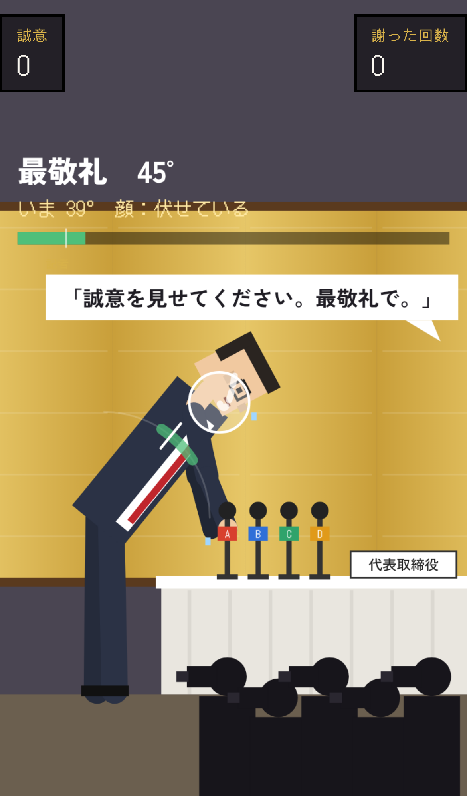
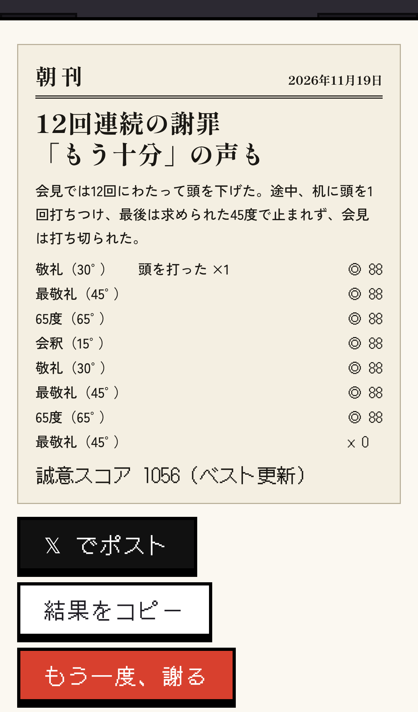

# 大変申し訳ございませんでした。

グネグネと言うことを聞かない体で、記者が求める角度のお辞儀を決め続ける、スマホ向けの謝罪会見ゲームです。

**▶ 遊ぶ：https://tamago-boro-156.github.io/owabi/**

| プレイ中 | 結果（翌朝の新聞） |
|---|---|
|  |  |

## 遊び方

1. 画面を指でつかんで引っぱると、頭がその方向へグネっと引き寄せられます。
2. 指を前に倒すほど深く頭が下がり、指を体に近づけるほど顔が伏せます。離すとゆっくり起き上がります。
3. 求められた角度で、顔を伏せ、ぐらつかずに止まると誠意がたまります。
4. 深すぎると机に頭をぶつけます。マイクも倒れます。

記者の注文は終わりません。求められた角度で止まれなかったら、そこで会見は打ち切りです。何回謝れるか。

## 特徴

- **グネグネの体**：腰はバネのように行き過ぎては戻り、首は腰の動きにつられて振れます。
- **だんだん厳しくなる注文**：成功するたびに、許される角度の幅（最初は ±15°）が狭まり、制限時間が短くなり、体の揺れが大きくなります。
- **記者のツッコミ**：角度や揺れ方に応じて「それは会釈ですか？」「床に何か落ちてます？」「こんにゃくみたいですよ」などの声が飛びます。
- **翌朝の新聞**：謝った回数や頭を打った回数に応じて、見出しが変わります。20回を超えると「謝り慣れすぎでは」と別の疑惑が浮上します。
- **スコアの共有**：結果の画面から、見出しとスコアを X にポストできます。

## 技術

- HTML / CSS / JavaScript の1ファイル（`index.html`）です。外部ライブラリは使っていません。
- 描画は Canvas 2D、効果音は Web Audio API で合成しています。
- 体の動きは、腰と首それぞれを「目標の角度に引き寄せるバネと減衰」で計算しています。そこに揺れを足して、グネグネした動きにしています。
- ベストスコアはブラウザの localStorage に保存します。

## 制作について

このゲームは、AIアシスタントの Claude（Anthropic）と対話しながら作りました。企画・ゲームの仕様・遊びやすさの判断・実機での確認とフィードバックを自分が担当し、コードの実装をAIが担当しました。
