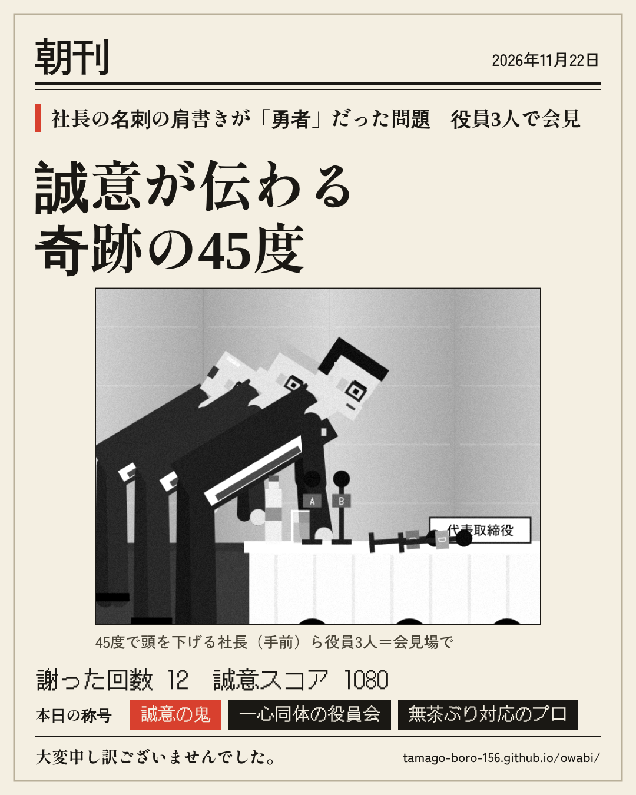

# 大変申し訳ございませんでした。

グネグネと言うことを聞かない体で、記者が求める角度のお辞儀を決め続ける、スマホ向けの謝罪会見ゲームです。

**▶ 遊ぶ：https://tamago-boro-156.github.io/owabi/**

| プレイ中 | 結果（翌朝の新聞） |
|---|---|
|  |  |

結果は、会見中の写真が載った朝刊の画像として X に投稿できます。

## 遊び方

1. 画面を指でつかんで引っぱると、頭がその方向へグネっと引き寄せられます。
2. 指を前に倒すほど深く頭が下がり、指を体に近づけるほど顔が伏せます。離すとゆっくり起き上がります。
3. 求められた角度で、顔を伏せ、ぐらつかずに止まると誠意がたまります。
4. 深すぎると机に頭をぶつけます。マイクも倒れます。

記者の注文は終わりません。求められた角度で止まれなかったら、そこで会見は打ち切りです。何回謝れるか。

## 特徴

- **グネグネの体**：腰はバネのように行き過ぎては戻り、首は腰の動きにつられて振れます。
- **はじめての会見はやさしめ**：はじめて遊ぶとき（ひとり・3人それぞれ）は、最初の3回の注文の幅と時間に余裕があり、体の揺れも小さくなります。1回目は指の動かし方の見本も出ます。
- **だんだん厳しくなる注文**：成功するたびに、許される角度の幅（最初は ±15°）が狭まり、制限時間が短くなり、体の揺れが大きくなります。
- **不祥事ガチャ**：「社長が会議中に寝ていた件」「取扱説明書が全部ポエムだった件」など、何の件で謝るかは会見のたびにランダムで決まります。記者のツッコミと翌朝の新聞も、その件に合わせて変わります。
- **会見の妨害と無茶ぶり**：4回目の謝罪からは、「顔を上げてください！」の逆注文、「今、笑っていませんでしたか？」（顔を深く伏せ続ける）、「責任は誰が取るんですか！」（社長だけさらに深く）、マイクのハウリング、隣の役員の体当たりが、ときどき起きます。
- **役員の裏切り**：3人のときは、専務や部長が突然直立したり、勝手に最敬礼したり、うなずき出したりします。
- **1回ごとの仕切り直し**：お辞儀が決まるたびに体はまっすぐ起き上がってから、次の注文が始まります。
- **役員3人で謝る**：社長・専務・部長の3人が並び、同じ指の動きにそれぞれの体でついてきます。おっとり遅れる専務、張り切って行き過ぎる部長の角度もそろえる必要があります。
- **記者のツッコミ**：角度や揺れ方に応じて「それは会釈ですか？」「床に何か落ちてます？」「こんにゃくみたいですよ」などの声が飛びます。
- **翌朝の新聞**：会見でいちばん目立った出来事が見出しになります。「社長、謝罪中に頭突き6連発」「誠意が伝わる奇跡の45度」「役員の足並みそろわず」など。20回を超えると「謝り慣れすぎでは」と別の疑惑が浮上します。
- **本日の称号**：「マイク破壊王」「誠意の鬼」「こんにゃく社長」「反省ゼロ」など、会見の内容に応じて最大3つの称号がつき、X の投稿にも入ります。
- **新聞の写真と画像での共有**：いちばん良い角度で止まった瞬間や、頭を打った瞬間を白黒の報道写真として新聞に載せます。新聞は1枚の画像になり、スマホでは「画像つきで投稿」からそのまま X に投稿できます。

## 技術

- HTML / CSS / JavaScript の1ファイル（`index.html`）です。外部ライブラリは使っていません。
- 描画は Canvas 2D、効果音は Web Audio API で合成しています。
- 体の動きは、腰と首それぞれを「目標の角度に引き寄せるバネと減衰」で計算しています。そこに揺れを足して、グネグネした動きにしています。
- ベストスコアはブラウザの localStorage に保存します。

## 制作について

このゲームは、AIアシスタントの Claude（Anthropic）と対話しながら作りました。企画・ゲームの仕様・遊びやすさの判断・実機での確認とフィードバックを自分が担当し、コードの実装をAIが担当しました。
